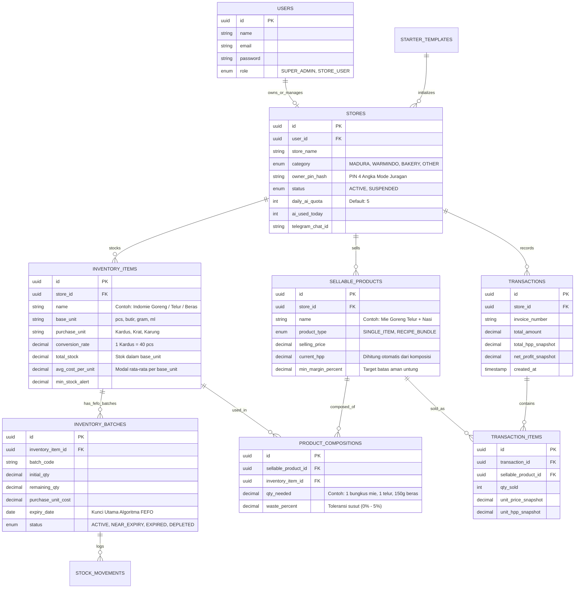

# System Architecture Document: ResepLaba (`ARCHITECTURE.md`)

* **Nama Proyek**: ResepLaba — Platform Kasir (POS), Konversi Inventori Racikan/Eceran, & Penjaga Margin Adaptif untuk UMKM Kecil
* **Kompetisi**: Garda Tech National Innovation Competition (GTNIC) 2026 — Kategori Web Development
* **Subtema**: *Accelerating Digital Transformation for Business and SMEs*
* **Arsitektur Utama**: *Decoupled Client-Server Architecture* (**Next.js App Router** + **Laravel 11 RESTful API** + **PostgreSQL/MySQL**)

---

## 1. High-Level System Architecture

Sistem menggunakan pendekatan terpisah (*decoupled*) antara antarmuka pengguna (**Next.js**) dan mesin logika bisnis (**Laravel**) agar responsif di perangkat *smartphone*, tablet, maupun desktop serta menjaga keamanan kalkulasi keuangan dan stok di sisi server.

```text
+===================================================================================+
|                           CLIENT PRESENTATION LAYER                               |
|                Next.js (App Router) + TypeScript + Tailwind CSS                   |
|                     (Hosted on Vercel Free Tier + Custom Domain)                  |
|                                                                                   |
|  +-------------------------+  +-----------------------+  +---------------------+  |
|  |   PANEL SUPER ADMIN     |  |  MODE PENJAGA WARUNG  |  | MODE JURAGAN (PIN)  |  |
|  | - Monitor & Ban UMKM    |  | - Kasir POS 1-Ketuk   |  | - Racikan & Konversi|  |
|  | - Starter Pack Template |  | - Input Kulakan/Nota  |  | - Laporan Laba Rugi |  |
|  | - Radar & Broadcast     |  | - Alert Barang Expired|  | - Simulator Harga   |  |
|  +-------------------------+  +-----------------------+  +---------------------+  |
+=========================================+=========================================+
                                          |
                                          | HTTPS REST API (JSON + Bearer Token)
                                          | + Header: X-Owner-PIN (Khusus Juragan)
                                          v
+===================================================================================+
|                        BACKEND API & BUSINESS LOGIC LAYER                         |
|                         Laravel 11 (PHP 8.3 API Server)                           |
|                                                                                   |
|  +-----------------------------------------------------------------------------+  |
|  |                        SECURITY & ACCESS MIDDLEWARE                         |  |
|  |  [Auth:Sanctum] -> [CheckStoreBanned] -> [VerifyOwnerPin] -> [AiQuotaLimit] |  |
|  +-----------------------------------------------------------------------------+  |
|                                                                                   |
|  +-------------------------+  +-----------------------+  +---------------------+  |
|  |   Unit & Recipe Engine  |  |   FEFO Batch Engine   |  | Margin Guard Engine |  |
|  | - Pecah Kardus -> Ecer  |  | - Potong Stok Tertua  |  | - Hitung HPP Aktual |  |
|  | - Potong Bahan Racikan  |  | - Deteksi H-3 Expired |  | - Rekomendasi Harga |  |
|  +-------------------------+  +-----------------------+  +---------------------+  |
+===================+===========================================+===================+
                    |                                           |
                    | Eloquent ORM (ACID DB Transaction)        | External REST / Webhook
                    v                                           v
+=======================================+   +=======================================+
|        DATA PERSISTENCE LAYER         |   |        EXTERNAL SERVICES LAYER        |
|  PostgreSQL (Supabase) / MySQL (Aiven)|   | - Cron-job.org (Trigger Pagi 07:00)   |
|  - Multi-Store Relational Tables      |   | - Google Gemini API (OCR Foto Nota)   |
|  - Row-Level Store Isolation          |   | - Telegram Bot API (Notif Expired)    |
|  - Immutable Stock & Financial Logs   |   | - WhatsApp Deep Link (wa.me Order)    |
+=======================================+   +=======================================+
```

---

## 2. Arsitektur Peran & Hak Akses (*3-Tier Role & PIN Architecture*)

Untuk menyesuaikan dengan realitas UMKM pinggir jalan (seperti Warung Madura, Warmindo, Warkop, dan Toko Roti rumahan) yang umumnya dikelola sendiri oleh pemilik atau dibantu 1–2 penjaga warung, sistem membagi kendali menjadi **2 Level Login** dan **1 Saklar PIN Internal**:

| Level Akses | Rute URL | Pengguna | Hak Akses & Kendali Sistem |
| :--- | :--- | :--- | :--- |
| **1. Super Admin (Platform Owner)** | `/admin/*` | Tim Pengembang (Anda) | • Memantau seluruh warung yang terdaftar.<br>• Melakukan **Suspend / Banned** akun warung yang melanggar aturan.<br>• Mengelola **Starter Pack Template** (Katalog instan Warung Madura / Warmindo / Toko Roti).<br>• Mengirim *Broadcast Banner* peringatan kenaikan harga bahan pokok.<br>• Mengatur batas kuota harian fitur *AI Scan Nota* per warung. |
| **2A. Akun Warung — Mode Penjaga (Default)** | `/app/pos`<br>`/app/stock` | Penjaga Warung / Kasir / Owner | • Melayani transaksi pembeli di layar Kasir POS.<br>• Mencatat barang kulakan masuk (manual atau foto nota) beserta tanggal kedaluwarsanya.<br>• Melihat peringatan barang yang hampir kedaluwarsa (FEFO) di etalase.<br>• **Tidak bisa** melihat total laba bersih atau mengubah harga jual dan resep. |
| **2B. Akun Warung — Mode Juragan (PIN Terbuka)** | `/app/owner/*` | Khusus Pemilik Warung (*Owner*) | • Dibuka menggunakan **PIN 4 Digit** tanpa perlu *logout* akun.<br>• Membuat komposisi **Racikan Menu / Konversi Satuan** (misal: 1 Mie Goreng = 1 Mie + 1 Telur + 150g Nasi).<br>• Menentukan harga jual, target margin, dan mencoba **Simulator Harga Naik**.<br>• Melihat laporan omzet, modal terpakai, dan laba bersih harian. |

---

## 3. Skema Basis Data & Diagram Relasi (ERD)

Skema basis data relasional di bawah ini dirancang untuk mendukung fitur konversi satuan grosir-ke-eceran, racikan resep menu, dan pelacakan kedaluwarsa berbasis *batch* (FEFO):



---

## 4. Alur Kerja Mesin Inti (*Core System Workflows*)

### A. Alur 1: Transaksi Kasir POS $\rightarrow$ Pemotongan Resep & Batch FEFO Otomatis
Saat penjaga warung menjual menu racikan atau eceran di kasir, Laravel menjalankan proses di dalam `DB::transaction()` agar data stok tidak pernah selisih:

```text
[Penjaga Warung] Klik "Mie Goreng Telur + Nasi" (2 Porsi) -> Klik [BAYAR]
       │
       ▼
[Next.js Client] POST /api/v1/pos/checkout { items: [{ product_id: "mie-spc", qty: 2 }] }
       │
       ▼
[Laravel API] Mulai DB::beginTransaction()
       ├── 1. Cek komposisi di tabel `product_compositions`:
       │      - Butuh Indomie : 1 x 2 = 2 pcs
       │      - Butuh Telur   : 1 x 2 = 2 butir
       │      - Butuh Beras   : 150g x 2 = 300 gram
       │
       ├── 2. Jalankan Algoritma FEFO pada tabel `inventory_batches`:
       │      SELECT * FROM inventory_batches
       │      WHERE inventory_item_id = ? AND remaining_qty > 0 AND expiry_date > TODAY
       │      ORDER BY expiry_date ASC FOR UPDATE;
       │      (Potong stok dari batch yang tanggal kedaluwarsanya paling dekat!)
       │
       ├── 3. Catat log pemotongan ke `stock_movements` & kurangi `total_stock`
       ├── 4. Simpan nota ke `transactions` beserta snapshot HPP & Laba Bersih detik itu
       └── 5. DB::commit() -> Kembalikan respons sukses & sisa porsi ke layar Kasir
```

### B. Alur 2: Input Kulakan Masuk $\rightarrow$ Konversi Satuan $\rightarrow$ Deteksi Kenaikan Modal (*Margin Guard*)
Saat pemilik atau penjaga memasukkan barang belanjaan baru dari agen/pasar:

```text
[Input Belanja] "Beli 1 Krat Telur (Isi 240 Butir), Harga Rp 600.000, Expired: 15 Nov 2026"
       │
       ▼
[Laravel Engine]
       ├── 1. Konversi Satuan Grosir ke Eceran/Dasar:
       │      1 Krat x 240 = +240 butir telur masuk ke `inventory_batches` baru.
       │      Modal baru per butir = Rp 600.000 / 240 = Rp 2.500 / butir.
       │
       ├── 2. Hitung Moving Average Cost (Modal Rata-rata Tertimbang):
       │      Misal modal lama Rp 2.000/butir -> Modal rata-rata naik jadi Rp 2.420/butir.
       │
       ├── 3. Re-kalkulasi Otomatis Semua Menu yang Memakai Telur (`sellable_products`):
       │      HPP "Mie Goreng Telur + Nasi" naik dari Rp 7.350 -> Rp 7.770.
       │
       └── 4. Cek Ambang Batas Margin:
              Jika Margin Baru < `min_margin_percent`, aktifkan bendera `is_margin_warning = true`
              dan tampilkan rekomendasi harga jual baru di Mode Juragan!
```

### C. Alur 3: Mesin Peringatan Kedaluwarsa Harian (*Zero-Cost Cron Scheduler*)
Untuk menjaga biaya operasional tetap Rp0 (*Free Tier*), penjadwalan menggunakan **Cron-job.org** yang memanggil *endpoint* khusus di Laravel setiap pukul 07:00 WIB:

1. **Cron-job.org** mengirim *request* `GET /api/v1/cron/daily-expiry-check?secret=TOKEN_RAHASIA`.
2. **Laravel** mencari seluruh baris di `inventory_batches` dengan kondisi `remaining_qty > 0` dan `expiry_date <= CURRENT_DATE + 3 days`.
3. Batch yang ditemukan diubah statusnya menjadi `NEAR_EXPIRY` (H-3 s.d. H-1) atau `EXPIRED` ($\le$ Hari ini).
4. Sistem memunculkan **Banner Merah/Kuning** di layar Kasir warung terkait serta mengirimkan pesan ringkasan otomatis ke **Telegram Bot** pemilik warung.

---

## 5. Rumus Matematika & Logika Bisnis Inti

### 1. Kalkulasi *Moving Average Cost* (Saat Restock Kulakan Baru)

$$\text{Biaya Rata-Rata Baru} = \frac{(\text{Stok Lama} \times \text{Biaya Lama}) + (\text{Stok Masuk} \times \text{Biaya Beli Baru})}{\text{Stok Lama} + \text{Stok Masuk}}$$

### 2. Kalkulasi HPP Menu Racikan / Paket (*Smart BoM*)

$$\text{HPP Menu} = \sum_{i=1}^{n} \left( \text{Takaran}_i \times \left(1 + \frac{\text{Waste}_i}{100}\right) \times \text{Biaya Rata-Rata Bahan}_i \right)$$

### 3. Rekomendasi Harga Jual pada *Margin Simulator*

$$\text{Rekomendasi Harga Jual} = \frac{\text{HPP Menu Baru}}{1 - (\text{Target Margin (\%)} / 100)}$$

---

## 6. Struktur Folder Proyek (*Repository Structure*)

Untuk memudahkan penilaian pada indikator **Kualitas Teknis & Arsitektur Pengembangan (20%)**, gunakan struktur *Monorepo* bersih berikut di GitHub:

```text
reseplaba-gtnic2026/
├── README.md                        # Dokumentasi utama, panduan instalasi & akun Demo Juri
├── ARCHITECTURE.md                  # Dokumen arsitektur sistem & ERD (berkas ini)
├── PRD_ResepLaba_Warung.md          # Product Requirements Document
├── AGENT.md                         # Panduan AI Coding Assistant & System Prompts
│
├── backend-laravel/                 # Backend REST API (Laravel 11)
│   ├── app/
│   │   ├── Http/
│   │   │   ├── Controllers/Api/
│   │   │   │   ├── AdminController.php       # Kendali Super Admin (Ban, Template, Broadcast)
│   │   │   │   ├── PosController.php         # Transaksi Kasir Cepat
│   │   │   │   ├── InventoryController.php   # Input Kulakan & Batch FEFO
│   │   │   │   ├── RecipeController.php      # Racikan Menu & Konversi Satuan
│   │   │   │   └── CronController.php        # Endpoint Pengecekan Expired Harian
│   │   │   └── Middleware/
│   │   │       ├── EnsureStoreIsActive.php   # Blokir warung yang terkena Banned
│   │   │       └── VerifyOwnerPin.php        # Proteksi PIN 4 Angka untuk Mode Juragan
│   │   ├── Models/                           # Model Eloquent (Store, InventoryItem, Batch, dll.)
│   │   └── Services/
│   │       ├── FefoStockService.php          # Logika pemotongan stok tertua (ACID)
│   │       ├── HppCalculatorService.php      # Rumus Moving Average & Margin Guard
│   │       └── GeminiAgentService.php        # Parser foto nota belanja ke JSON
│   ├── database/
│   │   ├── migrations/                       # Skema tabel database
│   │   └── seeders/
│   │       └── JudgeSandboxSeeder.php        # Data siap uji (Warung Madura & Warmindo)
│   ├── routes/
│   │   └── api.php                           # Definisi rute endpoint REST API
│   └── .env.example
│
└── frontend-nextjs/                 # Frontend Web App (Next.js App Router + Tailwind CSS)
    ├── src/
    │   ├── app/
    │   │   ├── (public)/login/               # Halaman Login + Tombol "1-Klik Simulasi Juri"
    │   │   ├── admin/                        # Dashboard Super Admin (Pengelola Platform)
    │   │   └── app/                          # Workspace Utama UMKM
    │   │       ├── pos/                      # Tab 1: Layar Kasir Jualan Cepat
    │   │       ├── stock/                    # Tab 2: Dapur, Kulakan & Alert Expired
    │   │       └── owner/                    # Tab 3: Kantong Laba, Racikan & Simulator (PIN Lock)
    │   ├── components/
    │   │   ├── pos/                          # Kartu produk kasir & keranjang cepat
    │   │   ├── owner/PinModal.tsx            # Modal input PIN 4 angka Mode Juragan
    │   │   └── shared/BroadcastBanner.tsx    # Banner info harga naik dari Super Admin
    │   └── lib/
    │       ├── api.ts                        # Axios/Fetch wrapper ke Laravel API
    │       └── marginSimulator.ts            # Kalkulasi slider simulasi harga (0ms client-side)
    └── .env.example
```

---

## 7. Spesifikasi Endpoint REST API Utama (Laravel $\leftrightarrow$ Next.js)

| Method & Endpoint | Middleware | Deskripsi Fungsional |
| :--- | :--- | :--- |
| `POST /api/v1/auth/sandbox-login` | `Public` | Masuk instan ke akun demo juri (pilih **Warung Madura**, **Warmindo**, atau **Super Admin**). |
| `GET /api/v1/admin/stores` | `Auth`, `Role:SUPER_ADMIN` | Menampilkan daftar seluruh UMKM pengguna beserta metrik transaksi & kuota AI. |
| `PATCH /api/v1/admin/stores/{id}/status` | `Auth`, `Role:SUPER_ADMIN` | Mengubah status warung menjadi `ACTIVE` atau `SUSPENDED` (*Banned*). |
| `POST /api/v1/admin/broadcasts` | `Auth`, `Role:SUPER_ADMIN` | Mengirim pengumuman inflasi/kenaikan harga bahan ke seluruh layar warung. |
| `POST /api/v1/inventory/restock` | `Auth`, `StoreActive` | Mencatat barang kulakan masuk, membuat *batch* FEFO baru, dan menghitung ulang HPP. |
| `POST /api/v1/inventory/ocr-receipt` | `Auth`, `StoreActive`, `AiQuota` | Mengirim foto nota ke Gemini API dan mengembalikan draf barang belanjaan. |
| `POST /api/v1/pos/checkout` | `Auth`, `StoreActive` | Memproses penjualan kasir dan memotong stok bahan/eceran secara otomatis dengan aturan FEFO. |
| `POST /api/v1/owner/recipes` | `Auth`, `StoreActive`, `OwnerPin` | Menyimpan komposisi racikan menu (contoh: Mie Goreng = 1 Mie + 1 Telur + 150g Beras). |
| `GET /api/v1/owner/profit-summary` | `Auth`, `StoreActive`, `OwnerPin` | Mengambil laporan omzet, HPP terpakai, laba bersih, dan daftar menu yang marginnya kritis. |

---

## 8. Strategi Deployment & Standar Keamanan

### A. Deployment Publik (Free Tier vs Modal Pelajar < Rp100.000)
1. **Frontend (Next.js)**: Di-*deploy* pada **Vercel (Hobby Free Tier — Rp0)** dengan dukungan HTTPS otomatis dan CDN global.
2. **Backend API (Laravel 11) & Database**:
   * **Opsi 100% Free Tier (Rp0)**: Kontainer Docker Laravel pada **Koyeb / Render Free Tier** + Database **Supabase PostgreSQL Free Tier** + *Keep-Alive Ping* via **Cron-job.org**.
   * **Opsi Dana Pelajar (~Rp45.000 – Rp65.000)**: Cloud Hosting/VPS Pelajar Indonesia untuk `api.reseplaba.my.id` + Domain `.my.id` / `.biz.id` (~Rp20.000/tahun) untuk menjamin waktu respons instan tanpa *cold-start* saat pengujian juri.

### B. Keamanan & Optimasi Performa
* **Pencegahan *Race Condition* Stok**: Pemotongan *batch* FEFO di Laravel menggunakan `lockForUpdate()` di dalam transaksi database (`ACID`) sehingga stok tidak pernah bernilai negatif.
* **Isolasi Data Antar-Warung**: Seluruh model menggunakan filter `store_id` sehingga data stok dan keuangan antar-warung terisolasi secara ketat.
* **Enkripsi Kredensial**: Password pengguna dan `owner_pin_hash` (PIN 4 angka Mode Juragan) dienkripsi menggunakan algoritma *Bcrypt*.
* **Kompresi Gambar di Sisi Client**: Foto nota belanja dikompresi di *browser* hingga di bawah `300 KB` sebelum diunggah agar tetap cepat pada jaringan seluler UMKM pinggir jalan.